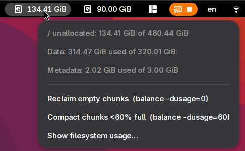
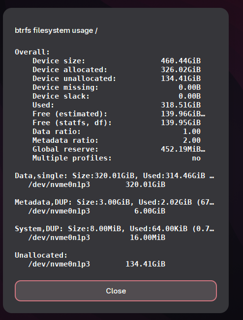

# Btrfs Guard — extensión de GNOME Shell

Indicador en el panel que vigila el **espacio no asignado** de tus sistemas de archivos btrfs y te ayuda a recuperarlo antes de que las escrituras se bloqueen.

<p align="center">
  
  
</p>

## Cómo funciona

btrfs no devuelve el espacio en disco a "sin asignar" cuando se borran archivos. El espacio se reparte en **fragmentos** (chunks) de tamaño fijo (normalmente 1 GiB para datos y 256 MiB para metadatos). Cuando btrfs se queda sin espacio sin asignar, no puede reservar nuevos fragmentos: los metadatos ya no pueden crecer y las escrituras se bloquean, aunque `df` aún muestre valores razonables. En ese punto, la recuperación es complicada.

Btrfs Guard supervisa continuamente el espacio sin asignar y ofrece equilibrado con un solo clic:

1. **Vigilancia**: para cada punto de montaje configurado, la extensión:
   - resuelve el UUID de btrfs y el dispositivo subyacente una sola vez (mediante `findmnt`), y después
   - lee los contadores de asignación desde sysfs (`/sys/fs/btrfs/<uuid>/allocation/*`) y el tamaño del dispositivo desde `/sys/class/block/<dev>/size`. No se llama a la CLI de `btrfs` ni se necesitan permisos de root, así que consultar cada 30 s es prácticamente gratis.
   - *Sin asignar = tamaño del dispositivo − Σ disk_total de los fragmentos de datos/metadatos/sistema.*
2. **Alerta**: cuando el espacio sin asignar baja de **1 GiB**, la etiqueta del panel se vuelve roja con un icono de advertencia y se lanza una notificación **crítica**; se vuelve a avisar como máximo cada 30 minutos hasta que se recupere espacio.
3. **Recuperación**: el menú ejecuta `pkexec btrfs balance start -dusage=N <mount>`:
   - `-dusage=0` libera los fragmentos completamente vacíos,
   - `-dusage=N` (por defecto **60**, configurable) compacta los fragmentos parcialmente usados y devuelve su espacio libre al pool de espacio sin asignar.
   El equilibrado requiere el umbral de uso de fragmentos: valores bajos son seguros pero recuperan menos; valores altos recuperan más pero reescriben más datos.
4. **Inspección**: un elemento del menú muestra `btrfs filesystem usage` para el punto de montaje en un diálogo desplazable.

## Ajustes

Se abren desde la aplicación *Extensiones* → Btrfs Guard → icono de engranaje (o con `gnome-extensions prefs btrfs-guard@ak0.org`):

- **Particiones vigiladas**: lista de puntos de montaje de btrfs; un indicador en el panel por cada uno. Añádelos manualmente o pulsa *Detectar montajes de btrfs* para rellenar automáticamente todos los sistemas de archivos btrfs a partir de `findmnt` (un montaje por sistema de archivos; se omiten los montajes obsoletos sin UUID).
- **Umbral de uso de fragmentos**: la `N` en `balance -dusage=N` (0–100 %, por defecto 60).

Los ajustes se guardan en GSettings bajo `org.gnome.shell.extensions.btrfs-guard`.

## Traducciones

Las cadenas visibles para el usuario están marcadas con gettext (dominio `btrfs-guard`). El ruso (`ru`) y el español (`es`) se incluyen de serie. Para añadir un idioma, crea `po/<lang>.po` a partir de `po/btrfs-guard.pot` (actualízalo con `xgettext --from-code=UTF-8 --keyword=_ -o po/btrfs-guard.pot extension.js prefs.js`), tradúcelo y después compila e instala:

```sh
mkdir -p locale/<lang>/LC_MESSAGES
msgfmt po/<lang>.po -o locale/<lang>/LC_MESSAGES/btrfs-guard.mo
```

## Instalar desde el código fuente

```sh
git clone https://github.com/catlion/btrfs-guard-gnome-ext.git
cd btrfs-guard-gnome-ext
glib-compile-schemas schemas
cp -r . ~/.local/share/gnome-shell/extensions/btrfs-guard@ak0.org
# cierra sesión / reinicia GNOME Shell para cargarla
```

## Requisitos

- GNOME Shell 48 o posterior
- btrfs-progs (`/usr/bin/btrfs`) y polkit (`pkexec`): se usan solo para las acciones de equilibrado y uso
